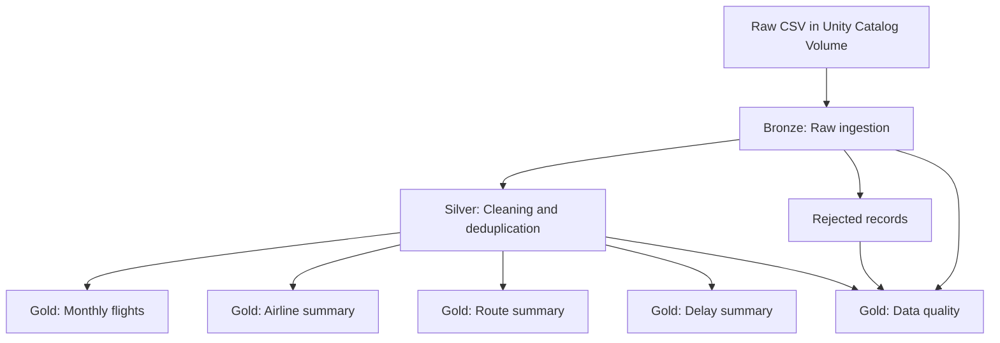

# Airline Flight Operations Analytics

End-to-end airline flight operations analytics project built with Databricks SQL using a Bronze–Silver–Gold data architecture.

## Project overview
The project ingests raw airline flight records, cleans and standardizes the data, separates rejected records, and creates analytical Gold views for operational reporting.

## Architecture

## Dataset and observed results
- Source file: `airline_flights_raw.csv`
- Raw Bronze rows: **1,365**
- Silver rows: **1,321**
- Rejected rows: **19**
- Duplicate flight IDs identified in Bronze: **25**
- Monthly Gold output: **12 rows** covering January–December 2025
- Silver passenger total: **181,030**

The duplicate count is a distinct-ID comparison. The rejected and duplicate classifications have not been demonstrated to be mutually exclusive, so the arithmetic reconciliation should be treated as a high-level check rather than a complete record-level audit.

## Repository structure
- `sql/01_bronze_ingestion.sql` — ingest raw CSV into Bronze
- `sql/02_silver_transformation.sql` — standardize, validate and deduplicate
- `sql/03_rejected_records.sql` — isolate records failing selected validation rules
- `sql/04_gold_monthly_flights.sql` — monthly KPIs
- `sql/05_gold_airline_summary.sql` — airline-level performance
- `sql/06_gold_route_summary.sql` — route-level performance
- `sql/07_gold_delay_summary.sql` — delay categories
- `sql/08_gold_data_quality.sql` — quality-count snapshot
- `sql/09_validation_queries.sql` — validation queries
- `pipeline/IMPLEMENTATION_NOTES.md` — implementation notes
- `screenshots/PROJECT_SCREENSHOTS.md` — eight supplied project images

## Project screenshots
See [all eight project screenshots](screenshots/PROJECT_SCREENSHOTS.md).

## Project screenshots
See [all eight project screenshots](screenshots/PROJECT_SCREENSHOTS.md).

## Databricks setup
1. Upload the source CSV to `/Volumes/workspace/flights/raw_files/`.
2. Use catalog/schema `workspace.flights`.
3. Run the SQL scripts in order in a Databricks SQL Warehouse.
4. Review the Gold views and build an AI/BI dashboard.

The SQL uses the source Volume path above. Update the path if your Volume location differs.

## Important implementation notes
- The tables/views in this project were created and queried using Databricks SQL.
- A separate automated Lakeflow pipeline deployment is not included.
- Missing delay values were not recalculated from scheduled and actual departure timestamps in this implementation.
- The rejected-record rules are the explicit checks in `03_rejected_records.sql`; they do not claim to capture every possible data-quality issue.
- The original CSV is not included. The supplied screenshots are embedded from their existing Medium CDN URLs; their binaries are not stored in this repository.

## Analytical highlights
- Sky Jet has the highest flight count among the named airlines in the Silver output.
- Coastal Air has the lowest average delay among the named airlines in the Silver output.
- Delay categories show most flights in the On Time group under the project's 15-minute threshold.

## Tools
Databricks SQL · Unity Catalog · SQL · AI/BI Dashboards · GitHub
