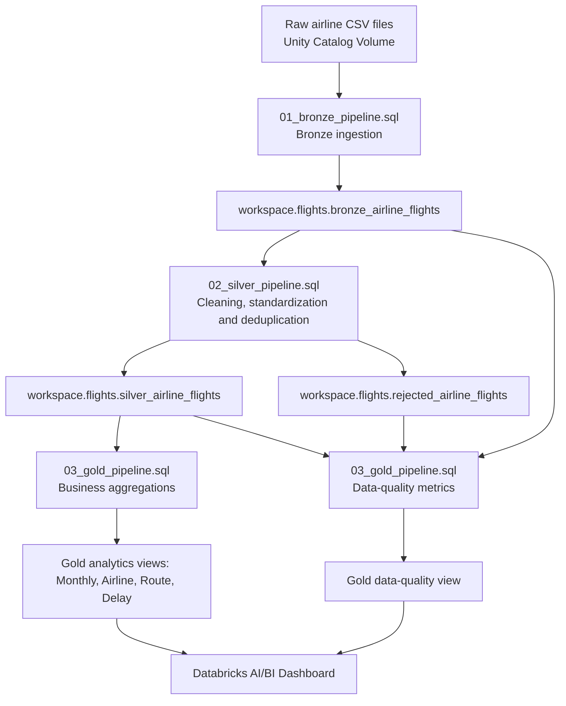

# Three-Pipeline Architecture

This project follows the Medallion (Bronze–Silver–Gold) architecture. The three SQL pipeline files in this folder implement the flow shown below.

## Pipeline responsibilities

1. **Bronze** — reads CSV files from the Unity Catalog Volume and preserves source metadata and load timestamp.
2. **Silver** — trims and standardizes selected fields, applies validation filters, deduplicates by `flight_id`, and exposes rejected rows separately.
3. **Gold** — creates analytics-ready materialized views for monthly flights, airline performance, routes, delay categories, and data-quality counts.

## Run order

Run the SQL files in this order after confirming the source Volume path and `workspace.flights` schema:

1. `01_bronze_pipeline.sql`
2. `02_silver_pipeline.sql`
3. `03_gold_pipeline.sql`

The scripts define Databricks SQL streaming/materialized tables and views; they are SQL pipeline definitions, not a pre-configured Databricks Workflows job.